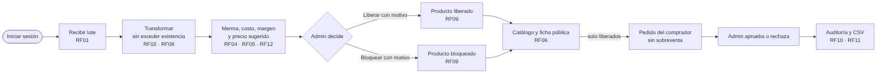
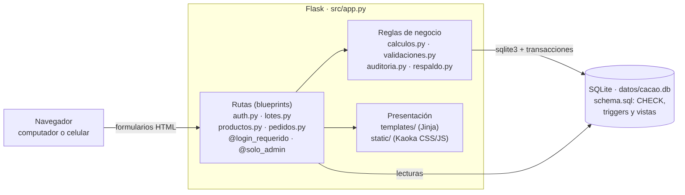
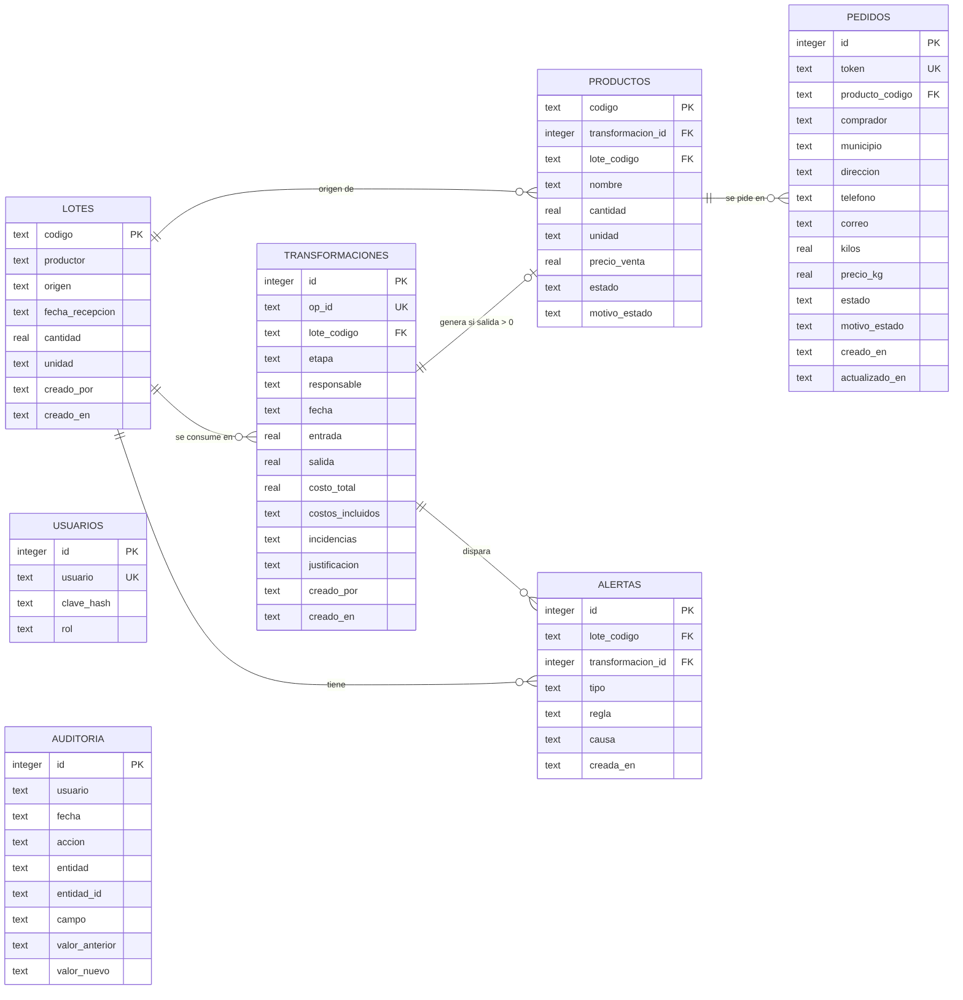
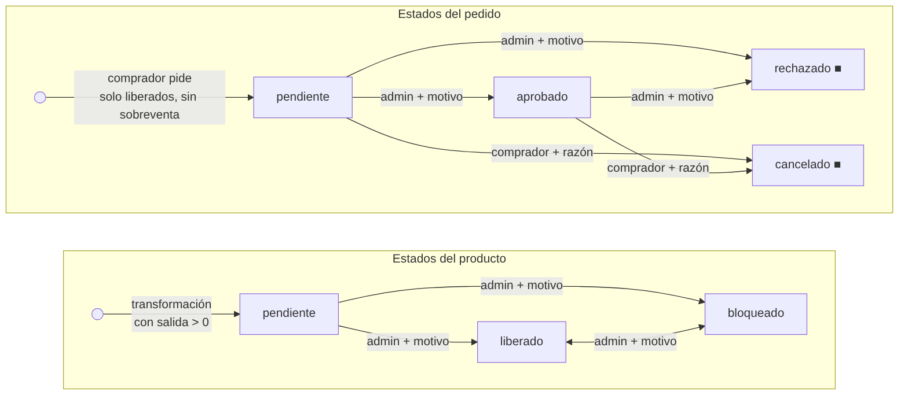

# E03 · Diseño del producto y de la solución

## Flujo de usuario

Operador: iniciar sesión → **Recibir lote** → **Transformar** (el sistema muestra cuánto queda
disponible). Administrador: **detalle del lote** con merma, costo, margen, precio sugerido y alertas →
**Liberar** o **Bloquear** con motivo → **Pedidos** (aprobar o rechazar) → **Auditoría** y **CSV**.
Comprador, sin cuenta: **Vista del comprador** (catálogo de productos liberados) → ficha por código o
enlace `/ficha/P-CAC001-1` → pedido por kilos → seguimiento con enlace privado.

## Arquitectura

Monolito modular en capas: **presentación** (plantillas Jinja + CSS/JS Kaoka) → **rutas Flask**
organizadas en cuatro *blueprints* (`auth`, `lotes`, `productos`, `pedidos`) → **reglas de negocio** (`calculos.py`
con funciones puras, `validaciones.py`, `auditoria.py`) → **datos** (SQLite con `schema.sql`).
Dependencias externas: solo Flask (incluye Werkzeug, Jinja2, Click) y pytest para pruebas.

| Ruta | Acceso | Qué hace |
| --- | --- | --- |
| `/login`, `/logout` | Público | Sesión con contraseña cifrada (hash Werkzeug) |
| `/lotes`, `/lotes/nuevo` | Operador y admin | Lista con filtros por origen y estado; recepción |
| `/lotes/<código>` | Operador y admin (indicadores económicos se muestran solo al admin) | Trazabilidad, indicadores, alertas, estados |
| `/lotes/<código>/transformar` | Operador y admin | Transformación con control de existencia |
| `/productos/<código>/estado` (POST) | Solo admin | Liberar o bloquear con motivo |
| `/comprador`, `/ficha/<código>` (`/consultar` redirige) | Público | Catálogo de liberados y ficha comercial sin datos internos |
| `/ficha/<código>/pedido` (POST), `/pedido/<token>`, `/pedidos/buscar` | Público | Crear, seguir o cancelar un pedido; solo con el enlace privado o con número y contacto |
| `/admin/pedidos`, `/admin/pedidos/<número>/estado` (POST) | Solo admin | Lista de pedidos; aprobar o rechazar con motivo |
| `/admin/auditoria`, `/admin/exportar.csv` | Solo admin | Historial filtrable y resumen CSV |

## Modelo de datos

| Entidad | Clave | Relaciones | Restricciones principales |
| --- | --- | --- | --- |
| usuarios | `id`; `usuario` único | — | `rol ∈ {operador, admin}` |
| lotes | `codigo` | 1 → N transformaciones, productos, alertas | `cantidad > 0`; campos obligatorios no vacíos |
| transformaciones | `id`; `op_id` único | `lote_codigo → lotes` | `entrada > 0`, `salida ≥ 0`; salida > entrada exige justificación; costo > 0 exige costos incluidos |
| productos | `codigo` (P-lote-n) | `transformacion_id`, `lote_codigo` | estado ∈ {pendiente, liberado, bloqueado}; distinto de pendiente exige motivo |
| alertas | `id` | `lote_codigo`, `transformacion_id` | tipo, regla y causa obligatorias |
| pedidos | `id` (PED-0001); `token` único | `producto_codigo → productos` | `kilos > 0`; correo válido; estado ∈ {pendiente, aprobado, rechazado, cancelado}; cerrado exige motivo |
| auditoria | `id` | `entidad`, `entidad_id` | solo se agregan filas |

Vistas: `v_inventario_lote` (recibido, consumido, disponible, costo y estados por lote),
`v_ficha_publica` (solo campos autorizados para el comprador) y `v_producto_disponible` (kg de cada
producto menos lo apartado por pedidos pendientes o aprobados).

## Estados, inventario y control de acceso

- **Estados:** un producto nace *pendiente* cuando una transformación tiene salida > 0. Solo el
  administrador lo pasa a *liberado* o *bloqueado*, siempre con motivo, y cada cambio queda auditado con
  valor anterior y nuevo. Solo un producto liberado aparece en el catálogo y se puede pedir.
- **Pedidos:** nacen *pendientes*; el administrador los *aprueba* (solo si el producto sigue liberado)
  o *rechaza* con motivo, y el comprador puede *cancelarlos* con una razón. Rechazado y cancelado son
  finales. Triggers impiden pedir un producto no liberado, pedir más de lo disponible, reabrir un
  pedido cerrado y borrar pedidos.
- **Inventario:** disponible = recibido − Σ entradas de sus transformaciones (vista). Un trigger
  `BEFORE INSERT` rechaza la transformación que exceda lo disponible (`INVENTARIO_INSUFICIENTE`), y el
  `op_id` único (generado al abrir el formulario) evita el doble consumo al reenviar.
- **Acceso:** `@login_requerido` protege las rutas internas; `@solo_admin` y `exigir_admin()` responden
  403 y registran el intento como «DENEGADO» en la auditoría. Ocultar botones es solo una ayuda visual.

**Dónde se aplican las reglas:** en el servidor (`lotes.py`, `productos.py`, `pedidos.py`, `auth.py`) y en la base de
datos (CHECK, triggers y vistas de `schema.sql`), dentro de transacciones. Si una regla falla, no queda
ningún registro parcial y el formulario conserva lo escrito.

## Decisiones técnicas

| Decisión | Razón | Alternativa descartada | Limitación |
| --- | --- | --- | --- |
| **SQLite** como base de datos | Cero instalación, funciona sin Internet, respaldo de un solo archivo, transacciones y triggers | PostgreSQL | Una escritura a la vez; para muchas asociaciones simultáneas se migraría |
| **Reglas críticas también en la base** (triggers de inventario e inmutabilidad) | Ni un error del código ni un acceso directo pueden consumir de más o borrar historial | Validar solo en Python | Los mensajes del trigger se traducen en `lotes.py` |
| **`op_id` único por formulario** | Idempotencia: el reenvío (F5, doble clic) no duplica el consumo | Desactivar el botón con JavaScript | Depende de que el formulario envíe el `op_id` que recibió al abrirse |
| **HTML renderizado en servidor** (sin API JSON) | Menos piezas, los permisos viven en un solo lugar, funciona en celulares modestos | SPA con API REST | Menos interactividad sin recargar la página |

## Pantallas

| Pantalla | Evidencia |
| --- | --- |
| Inicio de sesión | `evidencias/cp02_login_fallido.png` |
| Lotes y trazabilidad (lista, filtros, indicadores) | `evidencias/cp16_tras_reiniciar.png` |
| Recibir lote | `evidencias/cp03_lote_valido.png` |
| Transformar | `evidencias/cp07_transformacion.png` |
| Detalle del lote (recorrido, merma, costo, margen, precio sugerido, alertas, estado) | `evidencias/cp11_trazabilidad_admin.png` |
| Ficha pública (celular) | `evidencias/cp13_ficha_bloqueada_movil.png` |
| Auditoría | `evidencias/cp14_auditoria.png` |
| Vista del comprador (catálogo) | `evidencias/cp20_catalogo.png` |
| Pedido y seguimiento | `evidencias/cp23_pedido_creado.png` |
| Pedidos (administrador) | `evidencias/cp24_pedido_aprobado.png` |
| Vista móvil | `evidencias/movil_lotes.png`, `evidencias/movil_transformar.png` |

**Diferencias entre diseño y aplicación:** la primera versión usaba una interfaz sencilla
(`static/estilos.css`), que se reemplazó por el diseño Kaoka (`kaoka.css`, `kaoka.js`) con la misma
lógica y rutas. `estilos.css` se conserva en el repositorio pero las plantillas actuales usan Kaoka. La
consulta pública por código (`/consultar`) se integró en la Vista del comprador (`/comprador`), que
además tiene el catálogo y los pedidos; la ruta antigua redirige a la nueva.
